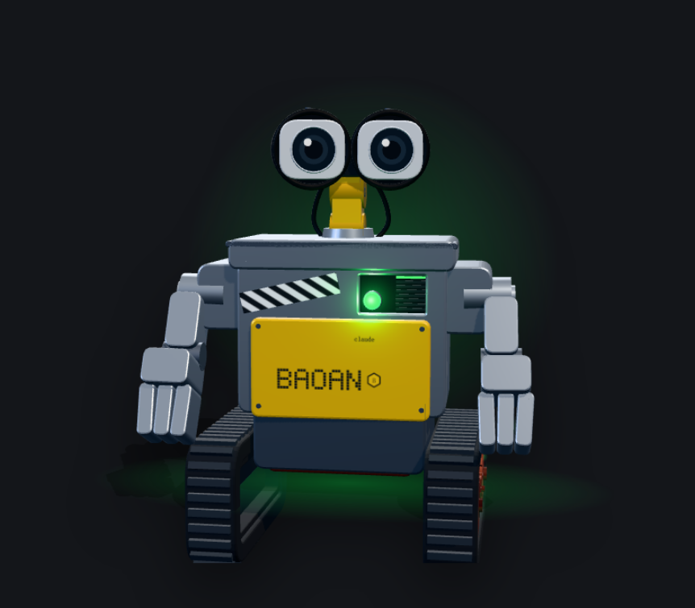

# baoanlight

[](https://github.com/baoan778/baoanlight/actions/workflows/test.yml)
[](https://github.com/baoan778/baoanlight/actions/workflows/release.yml)
[](LICENSE)
[](package.json)

一个常驻桌面角落的小机器人，替你盯着所有正在跑的 AI 编码代理。

作者 / 维护者：**[baoan778](https://github.com/baoan778)** · 项目地址：**[github.com/baoan778/baoanlight](https://github.com/baoan778/baoanlight)** · 落地页：**[baoan778.github.io/baoanlight](https://baoan778.github.io/baoanlight/)**

```
● 绿色   代理正在干活（亮 = 运行中）
● 黄色   代理停下来了，在等你（权限、提问、选择题）
● 红色   这一轮出错了，或者被卡住
● 紫色   这一轮刚刚成功完成（瞬态，30 秒后回到白色）
● 白色   代理还开着，但没在干活
● 灰色   有代理在运行，但我们没有拿到可读的状态
● 熄灭   没有代理在运行 / 未安装
```

绿色只属于「真的在干活」。空闲和未知都不借用红黄绿——否则同一个颜色会同时表示
「在忙」和「没忙」，而这个工具存在的意义就是不撒这种谎。



它是一台原创的卡通履带机器人（与任何影视角色、公司或商标均无关联）：干活时履带滚动、
爪子摆动、眼睛左右扫视；需要你时抬起双爪、胸口警示灯急促闪烁；完成后原地转一圈再连跳两下；
空闲时会自己找事做——张望、伸懒腰、抛接小球、抖擞、抬手端详手爪、转身巡视、点头致意。

机器人是**真正的 3D 模型**（three.js + WebGL），所有零件在加载时由代码建模，没有 .glb、没有贴图包、
不联网：它有体积、有高光、会在桌面上投下阴影，状态色是照在它身上的光而不是涂上去的颜色。
为了不给桌面常驻窗口添负担，动画帧率随状态降档（干活 60fps、待机 30fps、离线静止 15fps），
窗口隐藏即停，掉帧会自动降画质。

支持 **Windows 10 / 11**，支持 **Claude Code、Codex、DeepSeek Harness、WorkBuddy、
Gemini CLI、Aider、Cursor、opencode、Copilot、Cline、Windsurf、Qwen Code、Kimi**，
以及任何能执行一条命令或发一个 HTTP 请求的工具。

**能做什么**（全部本地，无遥测；仅启动时向 npm 查一次版本号）：

- **状态灯**：绿=运行、黄=需要你、红=失败、紫=刚完成（瞬态）、白=空闲，语义严格、绝不撒谎（见 [docs/state-design.md](docs/state-design.md)）
- **多代理同时盯**：胸口 8 段槽位灯 + 底座 16 段灯环，谁在跑、谁在拖后腿一眼可见
- **cc-switch 联动**：被接管后显示真实模型/供应商（「Claude Code 用 deepseek-v4.1-flash」）
- **情绪表情**：出错头顶冒火焰 + 虹膜发红，等待含泪跺脚，未知瞳孔放大，完成喷金色星星
- **自主动作**：空闲时自己张望、伸懒腰、抛接、抖擞、看手爪、巡视、点头，不再呆坐
- **互动**：拖拽会挣扎、连点三下悬空转圈、指针停手臂会张手爪，右键开设置、双击打招呼
- **自定义外观**：13 皮肤 / 10 瞳色 / 9 履带 / 10 配件 / 5 手爪 / 3 头型 / 4 镜筒 / 14 场景 / 36 灯效，一键随机换装、命名方案、配色主题
- **本机资源**：机器人下方一条 CPU / 内存占用（检测到 NVIDIA 显卡时多一行 GPU/显存；中性色跑马灯，可设为常驻 / 仅高负载 / 关闭，不借用状态色），设置里可以关掉
- **今日信息牌**：机器人旁一块金边招牌按你的选择显示今日时长（最多/合计/轮播）、需要你几个、今日完成数、会话数、时钟、今日目标进度或陪伴天数，另有「最近动态」时间线；按住牌子可以直接拖到任意位置（靠近原位会吸附），双击或设置里一键恢复默认
- **多会话展开**：一个软件开了多个窗口时，行尾的 ×N 可以点开，逐行显示每个会话的目录、状态、运行/静默时长和它正在做什么；点某条会话可聚焦该软件，行尾终端按钮或右键可在它自己的目录里开终端；超过 6 个会话自动折叠成「还有 N 个会话」，设置里也能改成默认展开
- **为什么是这个颜色**：展开一个软件后，能看到驱动当前状态的最近事件（时间 · 来源 · 事件 → 状态）、已静默时长，以及保守的卡住提示；阈值可在设置里调整（默认忙碌 15 分钟 / 等待 10 分钟）
- **桌面便签**：记下今天要做的事，勾掉它，双击就地改字；支持置顶、按「置顶 / 今天 / 更早 / 已完成」分组、删除后 6 秒内撤销、提醒稍后 10 分钟、导出 Markdown；Ctrl+Shift+M 打开整张便签，Ctrl+Shift+N 只快速记一条。面板关着时机器人脚边也有一张小纸片，和代理状态互不干扰
- **托盘常驻**：图标颜色跟随整体状态，鼠标悬停显示状态、会话数与今日累计（含最久的那个软件）
- **MCP**：`bao mcp` 让任何支持 MCP 的代理自己上报 `report_status`
- **开机自启 + 一条命令全起**：`bao autostart on` 只需启动 `bao start`；server、窗口和日志观察器会一起起来
- **整机自愈**：`bao start` 的脱离进程是守护者 —— 机器人整体崩溃会按 5s → 10s → 30s → 60s 自动重开；你主动退出或 `bao stop` 则不会被“复活”
- **可选语音/提示音**（默认关闭）

本项目原名 [signalhead](https://github.com/deepak-hp/signalhead)，后更名为
baoanlight：核心状态机与「安静不等于完成」等设计延续至今，界面与代理接入层已重写。
由 [baoan778](https://github.com/baoan778) 维护并开源发布。

---

## 目录

- [安装](#安装) · [快速上手](#快速上手) · [接入代理](#接入代理)
- [电量表](#电量表) · [同时观察多个代理](#同时观察多个代理) · [自定义系统](#自定义系统)
- [常见问题](#常见问题) · [平台支持](#平台支持) · [本机接线对不对](#本机接线对不对)
- [配置与本地文件](#配置与本地文件) · [本地安全](#本地安全) · [已知限制](#已知限制)
- [开发](#开发) · [相关文档](#相关文档) · [参与贡献](#参与贡献) · [授权](#授权)
- 部署到别人的电脑：[DEPLOY.md](DEPLOY.md)

---

## 安装

> 想把这台机器交给 AI 部署？把 [DEPLOY.md](DEPLOY.md) 发给它，里面是逐步执行、
> 验收和失败处理清单。

```bash
npm install -g baoanlight
bao setup        # 首次运行：下载 Electron 运行时（约 140 MB）
bao start
```

从源码跑：

```bash
git clone https://github.com/baoan778/baoanlight
cd baoanlight
npm install
npm run setup
node src/cli.js start
```

npm 上暂时还没有这个包时，可以直接从 GitHub Release 安装：

```bash
npm install -g https://github.com/baoan778/baoanlight/releases/download/v2.0.1/baoanlight-2.0.1.tgz
bao setup
```

不需要桌面窗口也可以：

```bash
bao start --browser      # 在浏览器标签里显示同一个机器人
```

> `setup` 单独一步，是因为 npm 11 默认拦截安装脚本，而 Electron 的二进制正是由那个脚本下载的。
> 升级会替换 `node_modules`，运行时随之丢失——`bao start` 发现后会自己重新拉取（有缓存，很快）。

---

## 快速上手

```bash
bao onboard            # 首次运行：探测装了哪些代理，引导接入
bao start              # 后台运行，立刻把终端还给你
bao connect claude     # 接入 Claude Code，立即生效，无需重启
```

`bao start` 默认脱离终端；关掉终端不会带走机器人。用 `bao stop` 停止，或
`bao start --foreground` 自己盯着它（Ctrl+C 干净退出）。它也会把日志观察器一起
拉起来并守护：观察器意外退出会按 5s → 10s → 30s → 60s 重启；启动时找不到日志
来源不会退出，而是每 30 秒重试，软件后来装好会自动接上。`--no-watch` 可关闭。
整机也一样：脱离出去的守护进程会发现 `start` 非零退出并把整套重新拉起来。

拖动机器人到任何位置，它会记住。鼠标悬停出现小工具栏：切换大/小尺寸、缩成小机器人、退出。
窗口默认点击穿透——除了机器人本身，鼠标点击都会落到下面的窗口上。

```bash
bao status             # 现在各个代理是什么状态
bao status --watch     # 每秒重绘，像 top 一样盯着看（Ctrl+C 退出）
bao status --json      # 同一份数据，给脚本/直播/第二屏用
bao agents             # 支持哪些代理、各自怎么接
bao clear              # 清掉崩溃代理留下的僵尸会话
bao doctor             # 体检：本机接线是否正确
bao demo               # 依次播放五种状态，检查动效
bao stop               # 全部关闭
```

---

## 接入代理

> 完整的分步接入指南见 **[docs/connecting.md](docs/connecting.md)**；不确定先接哪个，直接跑 `bao onboard`。

三层，越靠前越准。

| 软件 | 推荐接入 | 能显示 | 说明 |
|---|---|---|---|
| Claude Code | `bao connect claude` | 忙碌 / 等待 / 出错 / 空闲（按会话） | 八个生命周期钩子，立即生效 |
| Codex | `bao watch codex` 或 `bao connect codex` | 忙碌 / 等待 / 完成；日志还能给套餐额度 | notify 只报回合结束与等审批 |
| DeepSeek Harness | `bao watch deepseek` | 忙碌 / 等待 / 空闲；上下文电量 | 投影本身没有错误信号 |
| WorkBuddy | `bao connect workbuddy` 或 `bao watch workbuddy` | 忙碌 / 等待 / 完成 / 出错（看任务状态） | 任务板是粗粒度信息 |
| CodeBuddy / WorkBuddy CLI | `bao connect codebuddy` 或 `bao watch codebuddy` | 忙碌 / 等待 / 完成 | transcript 没有错误信号 |
| Gemini / Aider / Cursor / opencode / Copilot / Cline / Windsurf / Qwen / Kimi | `bao wrap -- <命令>` | 三态猜测 | 读终端屏幕 |
| 任何工具 | `bao hook --agent X`、HTTP `/state`、`bao mcp` | 由上报方决定 | 通用入口 |

> 数据源没有错误信号时，机器人不会亮红灯——这是刻意设计，不是漏报。要精确的失败状态，
> 用对应软件的 hook（`bao connect claude` / `bao connect codebuddy` 等）。

### 1. 代理自己的钩子 —— 精确

```bash
bao connect claude     # 写 ~/.claude/settings.json（--scope project 只写当前仓库）
```

Claude Code 的钩子不需要重启即可生效。钩子脚本 1.5 秒硬超时、任何异常都静默退出 0——
**永远不会因为指示灯坏了而卡住你的代理**。

### 2. 会话日志 —— 精确，且不用改代理配置

```bash
bao watch codex         # ~/.codex/sessions/YYYY/MM/DD/*.jsonl
bao watch deepseek      # dsh 的会话投影（JSON），或别名 bao watch dsh
bao watch workbuddy     # WorkBuddy 的任务板
bao watch codebuddy     # CodeBuddy / WorkBuddy 的逐轮对话 transcript
```

各自读的是：

- **Codex**：自己的 rollout JSONL，能给出忙碌/等待/完成，以及套餐额度。
- **DeepSeek Harness（dsh）**：`dsh` 的原始会话是 zstd 压缩的，但它会为每个会话维护一份
  明文 JSON 投影（`%APPDATA%\dsh-desktop\...\session_projcache\sessions`，设了 `DSH_HOME`
  则在 `$DSH_HOME\storages\...`）。观察器只读三行：`userQuestions` 有未答问题 → 黄灯，
  `turnBoundary.openTurnStartSeq` / `sessionStats.openStep` 非空 → 绿灯，回合已关闭 → 空闲（白灯）。
  它还会把 `contextPressure` 换算成「上下文还剩多少」，直接驱动电量条（这是唯一一个真实的
  剩余量，不是猜测）。
- **WorkBuddy**：读它的任务板（`~/.workbuddy/tasks`）——有任务 `in_progress` 即绿灯。
  **这是粗粒度信息**；要精确到「某一轮在等你」，用 `bao hook --agent workbuddy`。
- **CodeBuddy / WorkBuddy CLI**：读 `~/.workbuddy/projects/<项目>/<会话>.jsonl` 的逐轮记录 ——
  `reasoning` / `function_call` 是绿灯，助手回完这一轮是紫灯（随即回空闲）。只提取记录的
  类型与工具名，**正文不会进入状态、日志或任何输出**。任务板平时是空的，这个才是实时的那个来源。
  同一个家目录里两个产品共用这种 transcript，按路径归属：`~/.codebuddy` 记为 CodeBuddy，
  `~/.workbuddy` 或 cwd 里的 WorkBuddy 工作区记为 WorkBuddy —— 否则只开着 WorkBuddy 时，
  亮起来的会是「CodeBuddy」那盏灯。
  忙碌中的会话只要文件还在写就会定期重报（不是只在状态翻转时上报），否则长时间跑工具的
  一轮会在 90 秒后变暗、30 分钟后被当成失联丢掉。

如果它装在别处，直接指过去（`--dir` 仍按同一格式解析）：

```bash
bao watch deepseek --dir "$DSH_HOME/storages/session_projcache/sessions"
bao watch workbuddy --dir "D:/WorkBuddy/tasks"
```

如果 dsh 的目录里放的是别的 JSONL 日志，用 `--jsonl` 强制走通用读取器。

也可以写进配置，之后就不用每次带参数：

```json
{ "agents": { "workbuddy": { "dir": "D:/WorkBuddy/logs" } } }
```

日志解析是**宽容**的：`task_started` / `turn_complete` / `approval_request` / `needs_input`
以及 `{"state":"busy"}` 这类字段都能识别；token 数、思考增量、工具输出属于「环境噪声」，
只会给忙碌会话续命，**不会改变状态**——否则一条迟到的环境事件就能把刚变绿的机器人重新点亮。

### 3. 通用钩子 / 包装器 / 一行命令

如果某个工具能执行命令（但没有已知适配器），让它把事件打到 stdin：

```bash
bao hook --agent deepseek          # {"state":"busy"} / {"event":"task_complete"}
bao hook --agent workbuddy --state waiting --detail "approve plan?"
```

如果它只有终端界面：

```bash
bao wrap -- gemini
bao wrap -- aider --model sonnet
bao wrap --agent my-bot -- ./my-agent.sh
```

包装器用伪终端运行代理，字节原样透传，通过 `src/adapters/patterns.js` 里的正则读屏幕。
输出在流动 = 绿灯（正在干活）；停在确认提示上 = 黄灯（需要你回答）；停下来但没有提示 = 白灯（空闲）。
**这是很好的猜测，不是事实**——有钩子就用钩子。

如果以上都不行，还有一行 shell：

```bash
bao set busy    --agent deploy --detail "building"
bao set waiting --agent deploy --detail "approve prod push?"
bao set idle    --agent deploy
```

或从任何语言发 HTTP（写入要带本机 token，读不用，见「本地安全」）。Windows 上 PowerShell 就是现成的：

```powershell
$h = @{ 'x-bao-token' = (bao token) }
Invoke-RestMethod -Headers $h "http://127.0.0.1:4747/set/busy?agent=my-bot&session=manual&detail=thinking"
```

在 Git Bash / cmd 里也可以直接用 curl：

```bash
curl -s -H "x-bao-token: $(bao token)" \
  "http://127.0.0.1:4747/set/busy?agent=my-bot&session=manual&detail=thinking"
```

---

## 电量表

机器人右侧有一条竖直电量条，表示你还能用多久——套餐额度、上下文窗口、余额，随你定义。
从底部填充，满格到顶。填充色是中性石板灰：红/黄/绿在这个部件上已经代表
**代理状态**，不能再被电量复用。只有「快用完了」才变色：低于 25% 琥珀、低于 10% 红色。

Codex 会自己上报真实数字：

```bash
bao watch codex                 # 跟随套餐额度
bao watch codex --fuel context  # 或跟随上下文窗口占用
```

其他工具一行搞定：

```bash
bao fuel 63 --agent claude --label "plan quota"
bao fuel 12 --used --agent ci --label "build minutes"   # --used 表示「已用掉」
```

电量永远表示**剩余**，0–100。多个代理同时上报时，显示最空的那个——最先让你停摆的那个。
电量走独立通道，更新额度不会扰动指示灯。

---

## 同时观察多个代理

胸口的仪表板上有 **8 段固定槽位灯**，一个软件一段，左右顺序永远不变：

```
槽位:   deepseek  claude   codex   workbuddy   codebuddy   [3 个空位，给以后新增的]
          ●         ●        ●         ○            ○
         红        绿       黄        熄灭         熄灭
```

顺序就是 `src/store.js` 的 `AGENT_ORDER`（也是 `shared/palette.mjs` 的 `AGENT_SLOTS`，
测试盯着两者不许分叉）。同级时排在前面的那个拿走主灯，所以 DeepSeek Harness 是默认的
「主」软件——位置是契约的一部分，不要按心情重排。

- **段灯**常亮，任何一个软件的状态都不会被别的软件盖住——不用切换、不用轮播。
- **主灯**（大灯 + 地面溢光 + 全身姿态）只显示最要紧的那一个：
  **红 > 黄 > 绿 > 紫 > 灰白 > 白暗 > 熄灭**。
- **同级冲突**：按上面的固定顺序取靠前的那个，永远一致。谁后上报不影响结果，
  否则两个同优先级的软件会让主灯来回跳。
- **同一软件多开**：合成一段，显示最坏的那个，标签写 `×N`。
- 仪表板下方还有一行文字标签（颜色 + 名字），色觉障碍也能读。
- **桌面灯环**：底座一圈 16 段灯按软件分区，谁最要紧，谁的那一段就在跑马/呼吸/频闪，
  其余段常亮——「谁在拖后腿」和「还有谁在跑」能同时看到，不用切换。
- **槽位表由服务端下发**（`src/store.js` 的 `AGENT_ORDER`）：多接一个软件只需在那里
  加一个名字，界面自动多一行、灯环多一段，前端不用改；用户在设置里排过的顺序优先，
  服务端新增的软件追加在末尾。
- 窗口宽度固定、只向下生长，所以机器人永远钉在屏幕的同一个像素上。

手上能做的事：

| 操作 | 结果 |
|---|---|
| 右键机器人 | 弹出设置菜单（尺寸、外观、动作、系统、导入导出…） |
| 双击机器人 | 双臂抬起挥手两秒 |
| 单击机器人 | 抬头、眨眼、跳一下 |
| 连点三下 | 抓狂彩蛋：原地转两圈 + 抖动 + 悬空 |
| 拖动机器人 | 手臂乱摆、眼睛睁大（挣扎） |
| 指针停在眼睛上 | 只转头，身体不动——真的在看你 |
| 指针停在身上 | 整机转身，能看到侧面和背面 |
| 指针停在手臂上 | 手爪张开回应 |

「最近动态」在设置菜单里：本次运行期间谁完成了、谁需要你、谁出错，逐条带时间记录。

---

## 自定义系统

右键 → 设置里可以改的东西，全部写入 `~/.baoanlight/config.json`，重启不丢：

| 类别 | 选项 |
|---|---|
| 体型 / 尺寸 | Q版·标准·修长；70%–170% 缩放 |
| 皮肤 | 13 种（钛金白 / 做旧黄 / 军绿 / 金属银 / 碳纤黑 / 樱花粉 / 午夜紫…） |
| 瞳色 / 镜筒 | 10 种瞳色（含白瞳 / 玫红瞳）；圆·方·六边形·三角镜筒 |
| 履带 / 配件 | 9 种履带配色（含石墨 / 沙色）+ 3 种履带形状；10 种配件配色（含钛银 / 玫瑰金） |
| 手爪 / 胳膊 / 头型 | 5 种手爪、3 种胳膊、双筒·单眼·三眼 |
| 头部装饰 | 12 种：无 / 天线 / 安全帽 / 皇冠 / 眼镜 / 墨镜 / 围巾 / 背包 / 礼帽 / 领结 / 勋章 / 贝雷帽 |
| 场景 | 14 种：无 / 雪地 / 草原 / 沙漠 / 星空 / 岩浆 / 樱花 / 海洋 / 森林 / 雨夜 / 工厂 / 雪夜 / 黄昏 / 极光；可按时间自动在白天/夜晚场景间切换（夜晚时段支持跨午夜） |
| 灯光 | 36 种底座灯效、光环样式、灯光亮度 |
| 动作 | 5 个状态各配一种手势、待机频率、动效强度（省电/标准/华丽）、人格（活泼/沉稳/话痨/害羞，决定待机节奏与语气） |
| 配色主题 | 8 套一键套用；另有「随机换装」和命名「外观方案」（方案会一起保存/恢复场景自动切换与广告牌设置） |
| 软件 | 顺序、改名、每个软件在今日战绩里的展示色（可恢复默认）、逐个软件通知与提示音开关、日志目录覆盖 |
| 信息牌 | 最多 / 合计 / 轮播 / 需要你 / 今日完成 / 会话数 / 时钟 / 今日目标 / 陪伴天数 / 关闭；位置、颜色（含任意自定义色）、形状（圆角/胶囊/方正）；按住牌面可直接拖动（靠近原位会吸附），双击或「恢复默认位置」复位，拖过后标记「已自定义」；牌面副行自动显示完成/出错次数 |
| 日记 | 待办提醒间隔（关闭 / 15 / 30 / 60 / 120 分钟）、是否同时弹系统通知、启动时是否展开便签；待办支持置顶、分组、撤销删除、稍后提醒、导出 Markdown；数据存在 `~/.baoanlight/notes.json`，未完成的项目不会过期，完成超过 30 天自动清理 |
| 菜单摘要 | 设置面板顶部实时显示「配色 · 体型 · 场景 · 人格」，改任何一项即时更新 |
| 系统 | 提示音（风格+音量+完成音）、完成通知、语音播报、静音 30 分钟/1/2 小时、定时勿扰、点击穿透、开机自启、全局快捷键（开关 + 组合键）、显示未运行软件、默认展开多会话、显示模型、CPU/内存面板、列表行数、战绩/动态面板 |
| 工作记录 | 一键导出日报（Markdown，含今日/近 7 天/近 30 天）与逐行明细（CSV，按日期 + 软件） |

导入/导出：设置里的「导出配置」把以上全部打包成 JSON，「导入配置」一键恢复（`bao onboard` 负责首次接入引导）。

---

## 常见问题

**灯一直是熄灭的？**
先跑 `bao doctor`。Claude Code 需要 `bao connect claude`，并且在接入后**新开一轮对话**；
其他软件需要 `bao watch all` 能找到它们的日志目录。`bao agents` 会列出每种的接入命令。

**为什么它出错了，灯却没有变红？**
红灯只来自可验证的失败信号：Claude 的工具结果 `is_error`、日志里的 error 事件、
WorkBuddy 任务板的 failed/error 状态。DeepSeek 投影和 CodeBuddy/WorkBuddy transcript
本身不提供错误信号——这种情况下机器人宁可不知道，也不会猜一个红色。

**完成时为什么没有通知/提示音？**
检查设置里的「完成也弹通知 / 完成也响一声」。Claude Code 的 Stop 和 DeepSeek 的回合结束
都会按完成处理；用户主动取消（aborted / cancelled）不会报喜。提示音默认关闭，需要手动打开。

**同时跑好几个软件，状态会互相覆盖吗？**
不会。每个软件有固定槽位和固定列表行；同一软件多开只折叠成一行（显示最坏状态 + ×N），
主灯按固定优先级取所有软件里最要紧的那个。

**窗口不见了？**
点托盘图标，或按全局快捷键（默认 `Ctrl+Alt+B`）。拖到屏幕外时，显示/隐藏会自动把它搬回来。

**端口 4747 被占用？**
`bao start --port 4788`，或用 `bao status` 确认旧实例后 `bao stop`。

**数据存在哪里？怎么彻底卸载？**
全部在 `~/.baoanlight/`（配置、便签、统计、token）。`bao autostart off && bao stop` 后卸载包；
是否删除数据由你决定，详见 [DEPLOY.md](DEPLOY.md#8-升级与卸载)。

**会上传数据吗？**
不会。状态、日志、便签、统计都在本机；只有启动时向 npm 查一次版本号。

---

## 平台支持

| | 逻辑 | 悬浮窗口 |
|---|---|---|
| Windows 10 / 11 | 已验证 | 已验证 |

本项目只支持 Windows。核心是纯 Node，只有两个纯 JS 依赖（`zod`、
`@modelcontextprotocol/sdk`，`npm install` / 全局安装即装好）；窗口是 Electron
（可选），提供透明、点击穿透和置顶。

---

## 本机接线对不对

```bash
npm test         # 246 个逻辑测试：状态机、适配器、钩子、安装器、电量、鉴权、资源采样、证据链、调色板、事件契约、HTTP 请求体、配置落盘与导出覆盖、启动自检、整机守护、桌面待办、退出时统计落盘、终端安全
npm run test:ui  # 137 个渲染测试：机器人、系统面板、标签、多会话展开与折叠、证据链、桌面便签、电量条、CSP、XSS、朗读文本、键盘路径、帧率/降级预算、多软件并发/竞态、报错与完成提示、通知抑制与卡住阈值、每一项自定义控件的接线与重启恢复，以及落地页对比度
npm run test:electron  # Electron 主进程烟测：preload 桥、真实窗口、SSE 状态、五软件并发与置顶（需要 Electron）
npm run check:pack     # 发布前检查 npm 包内容：运行文件齐全、测试/密钥不会被打包
npm run lint     # 未定义的变量、声明了没用的变量、重复键、走不到的代码
bao doctor       # 本机：二进制、配置路径、日志目录、服务器
```

`npm test` 证明逻辑对；`doctor` 证明**这台机器**接线对——两者是不同的失败。

---

## 配置与本地文件

全部在 `~/.baoanlight/`（可用 `BAOANLIGHT_HOME` 覆盖）：

- `config.json` —— 端口、窗口位置、尺寸（`full`/`mini`）、是否折叠、`clickThrough`、
  是否显示标签、四个超时（`sessionTtlMs` / `idleTtlMs` / `quietAfterMs` / `unusedTtlMs`）、
  各代理日志目录 `agents`、每个软件的展示色 `agentColors`、全局快捷键 `hotkey` / `hotkeyOn`
- `hook-events.log` —— 每个钩子事件 → 状态映射的流水账（`BAOANLIGHT_LOG=0` 关闭）
- `token` —— 本机写入令牌（Windows 下继承用户目录 ACL，首次启动自动生成）。`bao token` 打印它；
  钩子、CLI、MCP 自己读，不需要你抄到任何地方
- `port`、`server.log`
- `.update-check.json` —— 最近一次 npm 版本检查的结果（24 小时内不再联网）

从旧版本升级时，第一次运行会把 `~/.signalhead/config.json` 复制过来，旧目录不删除。

---

## 本地安全

服务只绑 `127.0.0.1`，但「只绑回环」不等于「只有你」——浏览器允许任何网页往本机端口
发请求，一个 `` 就能让机器人替别人的网站
举手，而这个工具唯一的承诺就是灯不说谎。所以：

- **写入要 token。** `/set/*`、`POST /state`、`/clear`、`/quit` 都必须带
  `x-bao-token`（也接受 `?token=` 或 `Authorization: Bearer`）。`bao set`、
  `bao fuel`、各代理钩子、MCP 都已经自己读 `~/.baoanlight/token`，接线不用改。
- **读不设卡。** `/state`、`/events`、`/health` 免 token：`bao status`、机器人窗口、
  OBS 浏览器源照旧。
- **Host 和 Origin 都必须是本机。** 前者挡 DNS rebinding（`evil.com` 解析到
  127.0.0.1 时 Host 还是 `evil.com`），后者挡跨源读写；不再回显
  `Access-Control-Allow-Origin: *`，别的网页连你的工作目录都读不到。
- **渲染进程是沙箱。** 页面自带 CSP（`script-src 'self'`，没有内联脚本），Electron
  窗口 `sandbox: true` 且禁止跳转到别的地址；服务端来的字符串（软件名、detail、
  模型名）一律按文本渲染，不拼 HTML。
- **版本检查只问一句。** 启动时最多每 24 小时向 npm registry 请求一次最新版本号，
  结果缓存在 `~/.baoanlight/.update-check.json`；不发送会话、状态、路径或任何机器
  信息，离线、超时或被墙都静默忽略。

---

## 为什么有时候看起来「不对」

- **未知事件不动灯，但会说出来。** 早期版本把无法识别的事件当成 busy，结果一个意外 payload
  就把灯钉死，且无从排查。现在灯不动，仪表板会显示 `?` 并要求你去看 `hook-events.log`。
- **只报过到、没干过活的会话 2 分钟后清除。** 有些代理会打开会话然后默默消失，不发结束事件。
- **90 秒没上报的会话会变暗**，表示「这是我上次听到的，有一会儿了」，而不是「现在就是这样」。
- **空闲（白灯）30 分钟没人碰就遗忘**；崩溃或强杀不会发结束事件，否则它会在那里假装「随时可以开工」。
  **黄灯和红灯都不会自动消失**，等多久都在。
- **忙着的会话沉默不会变成空闲。** 它在深度思考、没有工具调用时可以几分钟不输出；沉默不是完成的证据。
  超过空闲窗口就直接丢弃，而不是改灯。
- **窗口断线时全部熄灭。** 断线不是代理的状态，是我们不知道；冻结的绿色会骗你去查看。
- **只报额度的上报不会凭空造出一个软件。** 一条迟到的 `token_count` / quota 事件属于某个
  已经在报状态的会话；如果那个会话已经不在了，这条上报会被直接忽略（电量也不会更新——
  额度和状态必须挂在同一个仍存活的会话上）。人手敲的 `bao fuel 63 --agent x` 是例外——
  那是你明确说「x 存在」，会建出一条完整会话。另外，只报额度不算「活动」：它不会续期
  会话的活跃时间，所以只发额度的幻影会话仍会照常过期。
- 每次事件都写进 `~/.baoanlight/hook-events.log`，这是区分「代理没发」和「我们映射错了」最快的方式。
  无法识别的事件只记录字段名与长度，**不记录内容**——这些载荷里常带 prompt 与工具输入。

---

## 已知限制

- 包装器的红色是正则匹配；某个 CLI 用奇怪措辞时你会看到绿色而不是红色，加一条正则即可。
- **dsh** 的状态来自它的投影文件，只有「开回合 / 开步骤 / 待回答问题」三个信号。如果 dsh
  被强杀，投影里会留下一个永远打开的回合，机器人会保持忙碌——该会话静默 30 分钟后自动
  丢弃（6 小时是任何会话的硬上限），也可以 `bao clear`。
- **WorkBuddy** 的任务板是计划状态，不是逐 token 状态；没有 `in_progress` 任务时它可能显示
  绿灯而实际仍在思考。要精确请用 `bao hook --agent workbuddy`。
- 其他代理的日志格式没有公开规范，解析是宽容匹配；改 `src/adapters/log-watch.js` 一处即可。
- 机器人的动效遵循 `prefers-reduced-motion`：系统开启「减少动态效果」后动作幅度归零，
  整场帧率降到 8fps（灯效本身不变，状态仍然可读）。

---

## 开发

```
src/server.js           HTTP + SSE，只绑 127.0.0.1
src/auth.js             本机写入 token + Host/Origin 校验（见「本地安全」）
src/store.js            会话、七种状态、电量、优先级
src/overlay/            机器人窗口（index.html 结构样式，ui.js 界面逻辑，robot3d.js 建模与动效）
  shared/palette.mjs    外观色值的唯一真源（界面色块与 3D 材质同读一份）
  scene/geometry.js     纯几何：尺寸进、BufferGeometry 出
  scene/surfaces.js     程序化纹理：锈迹、掉漆、地表、铭牌，全部现画
src/hooks/              claude.js / codex.js / event.js（通用）
src/adapters/
  agents.js             支持哪些代理、各自怎么接入、日志在哪
  log-watch.js          通用 JSONL 会话日志观察器（Codex 等）
  dsh-watch.js          DeepSeek Harness 会话投影观察器
  task-watch.js         WorkBuddy 任务板观察器
  watchdog.js           三个观察器共用的一条规矩：机器人退了就收摊
  install.js            写 Claude/Codex 配置
  wrap.js + patterns.js 伪终端包装器与输出正则
src/doctor.js           本机诊断
```

加一个「有日志的代理」只需在 `agents.js` 加条目、在 `log-watch.js` 补关键词；
加一个「只有终端的代理」只需在 `patterns.js` 加一组正则。

落地页（`docs/index.html`）里的机器人是**同一份 3D 代码**，不是另画的一张图：GitHub Pages
只发布 `docs/`，所以 `npm run build:pages` 把渲染代码复制到 `docs/demo/`。改完
`src/overlay/robot3d.js` 记得跑一次 —— `test/contracts.test.js` 会逐字节比对，忘了会红。
仓库自带 `.github/workflows/pages.yml`：在 Settings → Pages 把 Source 选成
「GitHub Actions」后，推送 `docs/` 会自动部署。

---

## 相关文档

- [部署说明（可交给 AI 执行）](DEPLOY.md)：环境检查、安装、验收、升级与卸载
- [状态与灯效设计](docs/state-design.md)：每种颜色、动作、聚合规则的验收清单
- [接入新的 AI 代理](docs/adapters.md)：日志观察器 / 钩子 / 包装器的实现规范
- [把任意工具接进来](docs/connecting.md)：钩子、HTTP、MCP、PTY 四种方式
- [更新记录](CHANGELOG.md)：版本变化与升级注意

## 参与贡献

欢迎提 Issue 和 Pull Request。改动前请先跑一遍：

```bash
npm run lint
npm test
npm run test:electron   # 需要先 `npm run setup` 安装 Electron
npx playwright install chromium   # 首次
npx playwright test
npm run check:pack      # 改了 package.json 的 files 后
npm run build:pages   # 如果改了 src/overlay/ 下的渲染代码
```

- 提交规范与代码约定见 [CONTRIBUTING.md](CONTRIBUTING.md)。
- 行为准则见 [CODE_OF_CONDUCT.md](CODE_OF_CONDUCT.md)，版本变化见 [CHANGELOG.md](CHANGELOG.md)。
- 发现安全问题请不要公开提 Issue，按 [SECURITY.md](SECURITY.md) 私下报告。
- 本项目遵循「颜色即事实」的原则：绿色只表示正在运行，任何改动都不能让灯说谎。

项目作者与维护者：[baoan778](https://github.com/baoan778)。

---

## 授权

MIT。项目版权归 [baoan778](https://github.com/baoan778/baoanlight) 所有，完整许可见
[LICENSE](LICENSE)。

渲染器内置 three.js（MIT），许可证头保留在 `src/overlay/vendor/` 的构建文件中；
完整的第三方版权与许可文本见 [THIRD_PARTY_NOTICES.md](THIRD_PARTY_NOTICES.md)。

Claude、Claude Code、Codex、DeepSeek、WorkBuddy、CodeBuddy、Cursor、GitHub Copilot、
Gemini、Aider、Qwen、Kimi 等名称与商标归其各自所有者。本项目仅用于描述兼容性，
与上述公司或产品没有隶属、赞助或背书关系。
